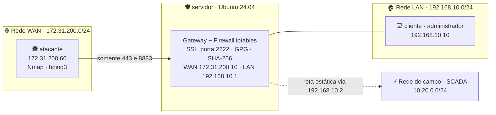

<div align="center">

# 🛡️ Segurança da Informação · Infraestrutura Crítica de Energia

### Trabalho Final · Grupo 9 · Setor de Energia e Smart Grid


*Firewall perimetral · Hardening do SO e do SSH · Criptografia assimétrica · Verificação de integridade*

</div>

---

## 📌 Sobre o projeto

Uma distribuidora de energia sofreu um incidente cibernético e contratou a nossa equipe para **reformular a segurança da infraestrutura de TI**, garantindo os pilares de **Confidencialidade, Integridade e Disponibilidade (CID)**, além de rastreabilidade e aderência às políticas internas.

O cenário é o de um **Smart Grid**: um servidor Ubuntu faz o papel de gateway e firewall entre a internet e a rede operacional, onde circulam protocolos de telemetria e automação industrial (**Modbus, DNP3, IEC 60870-5-104 e OPC UA**). Esses protocolos **não têm autenticação nem criptografia nativas**, e por isso o objetivo central da arquitetura é garantir que **nunca fiquem expostos à internet**.

Todo o laboratório sobe com **um único comando** (`docker compose up`) e pode ser reproduzido em qualquer máquina.

---

## 🏗️ Arquitetura



| Container | Papel | Endereços |
|:--|:--|:--|
| `servidor` | Gateway, firewall, SSH endurecido e serviços simulados | `172.31.200.10` (WAN) · `192.168.10.1` (LAN) |
| `cliente` | Administrador da rede interna (SSH e GPG) | `192.168.10.10` |
| `atacante` | Invasor externo (Nmap e hping3) | `172.31.200.60` |

### Exposição dos serviços

| Porta | Serviço | Quem acessa |
|:--:|:--|:--|
| 443 | Painel web de monitoramento (HTTPS) | 🌐 Internet |
| 8883 | Telemetria dos medidores inteligentes (MQTT/TLS) | 🌐 Internet |
| 2222 | SSH administrativo (só chave) | 🏠 Somente LAN |
| 502 | Modbus/TCP | 🏠 Somente LAN |
| 20000 | DNP3 | 🏠 Somente LAN |
| 2404 | IEC 60870-5-104 | 🏠 Somente LAN |
| 4840 | OPC UA | 🏠 Somente LAN |

---

## ✅ O que foi implementado

| Módulo | Requisito | Implementação | Arquivo |
|:--|:--|:--|:--|
| **2 · Rede** | IP estático e rota estática | `ipv4_address` no Compose e rota `10.20.0.0/24 via 192.168.10.2` | [`docker-compose.yml`](trabalho-seguranca-grupo9/docker-compose.yml), [`servidor-entrypoint.sh`](trabalho-seguranca-grupo9/docker/servidor-entrypoint.sh) |
| **2 · Firewall** | Política `DROP` em INPUT e FORWARD | Negar por padrão; só passa o liberado | [`firewall.sh`](trabalho-seguranca-grupo9/scripts/firewall.sh) |
| | Portas estritamente necessárias | 443 e 8883 públicas; SSH, DNS e protocolos industriais só na LAN | [`firewall.sh`](trabalho-seguranca-grupo9/scripts/firewall.sh) |
| | Proteção contra port scan | Bloqueio de flags Null/Xmas/FIN e banimento de 5 min (`recent`) | [`firewall.sh`](trabalho-seguranca-grupo9/scripts/firewall.sh) |
| | Rate-limit contra força bruta e DoS | SSH: 3 conexões/min por IP · SYN: 25/s por IP · `connlimit` nos serviços públicos | [`firewall.sh`](trabalho-seguranca-grupo9/scripts/firewall.sh) |
| **2 · Hardening** | SSH seguro | Porta 2222, sem root, `AllowUsers`, somente chave, cifras modernas | [`sshd_config`](trabalho-seguranca-grupo9/config/sshd_config) |
| | Sistema operacional | Permissões em `/etc` e `/var/log`, remoção de pacotes, atualização, `sysctl` de rede | [`hardening.sh`](trabalho-seguranca-grupo9/scripts/hardening.sh) |
| **3 · Criptografia** | Gestão de chaves GPG | 3 administradores, chaves `ed25519`, assinatura mútua, troca cifrada | [`Testes · T18`](trabalho-seguranca-grupo9/evidencias/TESTES.md#t18--gpg-troca-criptografada-de-credenciais) |
| **3 · Integridade** | Hashes SHA-256 com alerta | Monitora `/etc/passwd`, `/etc/shadow`, `rules.v4` e as regras ativas | [`integrity_check.sh`](trabalho-seguranca-grupo9/scripts/integrity_check.sh) |

---

## 🚀 Início rápido

### Requisitos

- **Docker** com Docker Compose v2 (`docker compose version`)
- **Linux nativo** é o ideal. No Windows/macOS (Docker Desktop) o firewall pode depender dos módulos do kernel do WSL2; o passo 2 abaixo verifica isso.
- No Windows, clone com `git config --global core.autocrlf false` (o repositório já traz `.gitattributes` forçando fim de linha LF nos scripts).

### Passo a passo

```bash
# 1) Clonar e subir o laboratório
git clone https://github.com/Janiele-Machado/SetordeEnergiaeSmartGrid_trabalhoFinal
cd trabalho-seguranca-grupo9
docker compose up -d --build

# 2) Verificar se o kernel suporta o firewall (tudo deve dar [OK])
docker compose exec servidor bash /opt/projeto/scripts/verificar_modulos.sh

# 3) Hardening do sistema e do SSH
docker compose exec servidor bash /opt/projeto/scripts/hardening.sh admin_grid

# 4) Testar o acesso por chave na nova porta (a partir do cliente)
docker compose exec cliente ssh -p 2222 admin_grid@192.168.10.1

# 5) Aplicar o firewall
docker compose exec servidor bash /opt/projeto/scripts/firewall.sh

# 6) Criar a linha de base de integridade e verificar
docker compose exec servidor bash /opt/projeto/scripts/integrity_check.sh --init
docker compose exec servidor bash /opt/projeto/scripts/integrity_check.sh --check
```

> **Para registrar as evidências do "antes e depois"** (Nmap, SSH como root etc.), não aplique tudo de uma vez: siga a ordem do [plano de testes](trabalho-seguranca-grupo9/evidencias/TESTES.md). Alguns testes precisam ser feitos **antes** do hardening e do firewall.

### Acessar os containers

```bash
docker compose exec servidor bash
docker compose exec cliente bash
docker compose exec atacante bash
```

### Parar, reiniciar e limpar

```bash
docker compose stop          # para, mantendo tudo (hardening, chaves GPG)
docker compose start         # volta; o firewall é reaplicado automaticamente
docker compose down -v       # apaga TUDO e volta ao estado inicial vulnerável
```

> ⚠️ `docker compose down` recria os containers e **apaga o hardening do SSH e as chaves GPG privadas**, que ficam dentro deles. Para pausar, use `stop`/`start`.

---

## 🧩 Scripts

| Script | Função | Como usar |
|:--|:--|:--|
| [`verificar_modulos.sh`](trabalho-seguranca-grupo9/scripts/verificar_modulos.sh) | Testa se o kernel do host oferece os módulos do netfilter usados | `bash verificar_modulos.sh` |
| [`hardening.sh`](trabalho-seguranca-grupo9/scripts/hardening.sh) | Endurece o SO e o SSH (detecta se está em container ou VM) | `bash hardening.sh <usuario_admin>` |
| [`firewall.sh`](trabalho-seguranca-grupo9/scripts/firewall.sh) | Aplica o firewall iptables; detecta as interfaces WAN/LAN pela rede | `bash firewall.sh [--safe]` |
| [`integrity_check.sh`](trabalho-seguranca-grupo9/scripts/integrity_check.sh) | Cria a linha de base e valida os hashes SHA-256 | `bash integrity_check.sh --init` ou `--check` |

O servidor também executa o `--check` **automaticamente a cada 60 segundos** (variável `INTEGRITY_INTERVAL` no `docker-compose.yml`) depois que a linha de base existe.

---

## 📂 Estrutura do repositório

```
README.md                           # README geral do projeto
trabalho-seguranca-grupo9/
├── docker-compose.yml             # topologia: redes, IPs e volumes
├── docker/
│   ├── Dockerfile.servidor
│   ├── Dockerfile.ferramentas     # imagem do cliente e do atacante
│   ├── servidor-entrypoint.sh     # rota estática, SSH, firewall no boot
│   ├── ferramentas-entrypoint.sh
│   └── servicos_simulados.py      # portas 443, 8883, 502, 20000, 2404, 4840
├── scripts/
│   ├── verificar_modulos.sh
│   ├── hardening.sh
│   ├── firewall.sh
│   └── integrity_check.sh
├── config/
│   ├── sshd_config                # SSH endurecido (template)
│   └── referencia-vm/01-netcfg.yaml   # netplan, caso seja exigida VM
├── gpg/                           # chaves públicas exportadas (.asc)
├── evidencias/
│   ├── TESTES.md                  # passo a passo completo de execução com plano de testes contendo prints e saídas dos testes
└── docs/
    └── RELATORIO_DE_TESTES.md     # relatório com evidências
```

---

## 📚 Documentação

| Documento | Conteúdo |
|:--|:--|
| [📖 `evidencias/TESTES.md`](trabalho-seguranca-grupo9/evidencias/TESTES.md) | Passo a passo detalhado de execução, problemas comuns e diferenças entre VM e Docker, com os 20 testes, comandos, resultados esperados e evidências |

---

## 🔑 Credenciais do laboratório

| Usuário | Senha | Observação |
|:--|:--|:--|
| `root` | `root123` | Fraca **de propósito**, para demonstrar o "antes" do hardening. Depois dele, o root não entra mais por SSH |
| `admin_grid` | `admin123` | Depois do hardening, só entra por **chave pública** |

> Essas credenciais existem **apenas** neste ambiente de laboratório isolado.

---

## ⚖️ Decisões de projeto e limitações

- **Docker em vez de VM:** o kernel é compartilhado com o host. Por isso `auditd` e os parâmetros `kernel.*` não se aplicam; a auditoria é feita pelo verificador SHA-256 e pelo log do SSH (`/var/log/sshd.log`). As diferenças entre Docker e VM estão no [plano de testes](trabalho-seguranca-grupo9/evidencias/TESTES.md).
- **Serviços industriais simulados:** as portas 502, 20000, 2404 e 4840 respondem só com um banner. O foco é a **proteção do perímetro**, não a implementação dos protocolos.
- **Nomes de interface variáveis:** o Docker pode trocar `eth0` e `eth1` entre reinícios. Por isso o `firewall.sh` detecta WAN e LAN **pela rede** e é reexecutado a cada boot, em vez de restaurar um arquivo salvo.
- **Logs do iptables:** o alvo `LOG` não escreve dentro de containers. A evidência dos bloqueios vem dos **contadores** (`iptables -L -n -v`) e da lista de IPs banidos (`/proc/net/xt_recent/PORTSCAN`).
- **Chaves GPG do laboratório:** o chaveiro privado fica dentro do container. Em produção ele ficaria em hardware seguro ou em cofre, e a senha da chave seria forte.

---

## 🩹 Problemas comuns

| Problema | Solução |
|:--|:--|
| `bad interpreter: /usr/bin/env bash^M` | Fim de linha do Windows. `git config core.autocrlf false`, apague a pasta e clone de novo |
| `verificar_modulos.sh` mostra `[FALHA]` | O kernel do host não tem o módulo. Veja as alternativas na saída do script (Linux nativo ou VM Linux com Docker) |
| Fui banido do próprio servidor por scan | `docker compose exec servidor sh -c "echo / > /proc/net/xt_recent/PORTSCAN"` |
| `The system cannot find the file specified` ao rodar `docker compose` | O Docker Desktop não está aberto. Abra-o e espere o motor iniciar |
| Cliente sem acesso à internet depois de reiniciar | Reaplique o firewall: `docker compose exec servidor bash /opt/projeto/scripts/firewall.sh` |

Mais orientações estão no [plano de testes](trabalho-seguranca-grupo9/evidencias/TESTES.md).

---

## 👥 Equipe

| Integrante | 
|:--|:--|
| Janiele de Farias Machado| 
| Arthur Henrique Dias do Couto | 
| Emanuel | 

**Disciplina:** Segurança da Informação · **Curso:** Bacharelado em Sistemas de Informação · **Período:** 6º · **Ano:** 2026

---

<div align="center">

⚠️ **Uso exclusivamente educacional.** As técnicas de ataque (Nmap, hping3) foram usadas apenas contra o ambiente de laboratório criado neste projeto.

</div>
