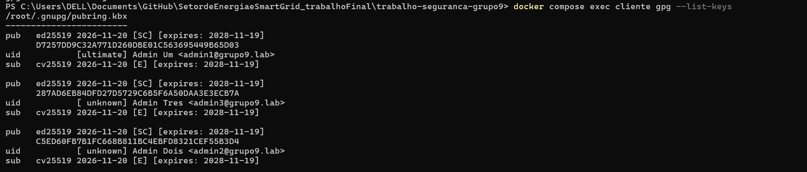
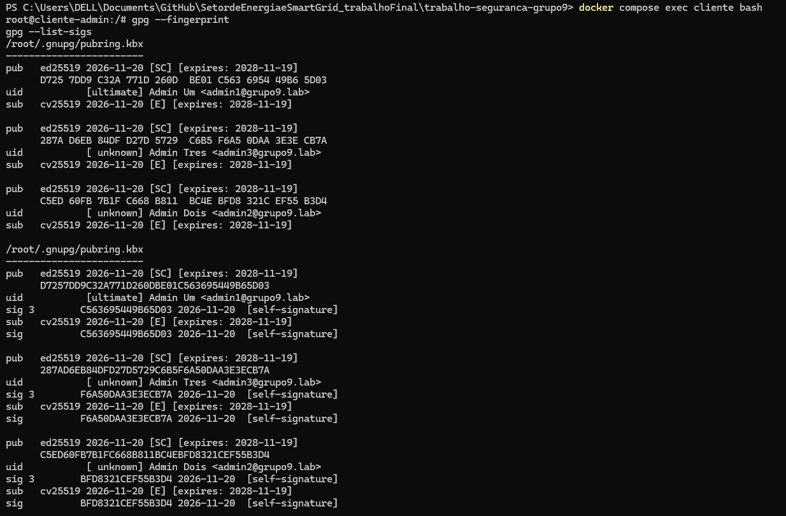
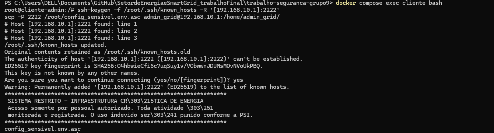
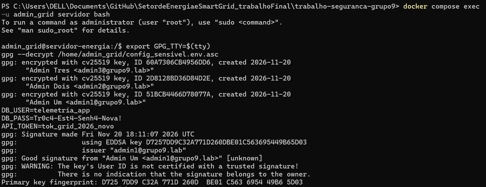
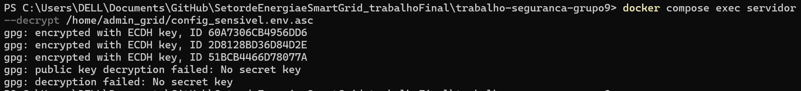

<div align="center">

# 🛡️ Relatório de Testes e Evidências

### Segurança da Informação · Infraestrutura Crítica de Energia

**Grupo 9 · Setor de Energia e Smart Grid**
Bacharelado em Sistemas de Informação · 6º período · 2026

`Firewall iptables` · `Hardening Ubuntu` · `SSH por chave` · `GPG` · `Integridade SHA-256`

</div>

---

## 📌 Sumário executivo

Este documento registra, **teste a teste**, como a infraestrutura proposta pelo Grupo 9 se comporta diante de ataques e de uso legítimo. Cada seção explica **o que foi testado e por quê**, mostra **o comando executado**, descreve **o resultado obtido** e traz a **evidência** (captura de tela).

O cenário é o de uma distribuidora de energia: um servidor Ubuntu faz o papel de gateway e de firewall entre a internet e a rede operacional, onde circulam protocolos de telemetria e automação industrial (Modbus, DNP3, IEC 60870-5-104 e OPC UA). Esses protocolos **não possuem autenticação nem criptografia nativas**, e por isso o grande objetivo da arquitetura é garantir que **nunca fiquem expostos à internet**.

### O que foi comprovado

| Pilar | O que os testes demonstram |
|:--|:--|
| 🔒 **Confidencialidade** | Credenciais trocadas apenas cifradas com GPG; SSH somente por chave; protocolos industriais invisíveis para a internet |
| ✅ **Integridade** | Qualquer alteração em `/etc/passwd`, `/etc/shadow` ou nas regras do firewall gera alerta automático |
| ⚡ **Disponibilidade** | Limites de taxa contra SYN flood e força bruta mantêm o serviço de pé durante o ataque |
| 🔎 **Rastreabilidade** | Logs do SSH e do verificador de integridade registram cada evento com data e hora |

---

## 🧭 Ambiente de teste

O laboratório roda em **Docker**, com três containers e duas redes:

```
 [ atacante ]                  [ servidor ]                     [ cliente ]
 172.31.200.60  ──(WAN)──  172.31.200.10 │ 192.168.10.1  ──(LAN)──  192.168.10.10
  Nmap · hping3             gateway + firewall + SSH           administrador
                                   │
                  rota estática 10.20.0.0/24 via 192.168.10.2
                       (rede de campo / subestações)
```

| Container | Papel | Endereço(s) |
|:--|:--|:--|
| `servidor` | Ubuntu 24.04: gateway, firewall iptables, SSH e serviços simulados | `172.31.200.10` (WAN) · `192.168.10.1` (LAN) |
| `cliente` | Administrador da rede interna (SSH e GPG) | `192.168.10.10` |
| `atacante` | Invasor externo (Nmap e hping3) | `172.31.200.60` |

**Serviços simulados no servidor:**

| Porta | Serviço | Exposição prevista |
|:--:|:--|:--|
| 443 | Painel web de monitoramento (HTTPS) | 🌐 Pública |
| 8883 | Telemetria dos medidores inteligentes (MQTT/TLS) | 🌐 Pública |
| 2222 | SSH administrativo | 🏠 Somente LAN |
| 502 | Modbus/TCP | 🏠 Somente LAN |
| 20000 | DNP3 | 🏠 Somente LAN |
| 2404 | IEC 60870-5-104 | 🏠 Somente LAN |
| 4840 | OPC UA | 🏠 Somente LAN |

---

## 📚 Índice

- [Parte A · Rede e roteamento](#parte-a--rede-e-roteamento)
  - [T01 · Laboratório no ar](#t01--laboratório-no-ar)
  - [T02 · Compatibilidade do kernel](#t02--compatibilidade-do-kernel)
  - [T03 · IP estático e roteamento estático](#t03--ip-estático-e-roteamento-estático)
  - [T04 · Conectividade e NAT](#t04--conectividade-e-nat)
- [Parte B · Hardening do sistema e do SSH](#parte-b--hardening-do-sistema-e-do-ssh)
  - [T05 · O "antes": ambiente vulnerável](#t05--o-antes-ambiente-vulnerável)
  - [T06 · Aplicação do hardening](#t06--aplicação-do-hardening)
  - [T07 · Configuração efetiva do SSH e permissões](#t07--configuração-efetiva-do-ssh-e-permissões)
  - [T08 · Root e senha bloqueados no SSH](#t08--root-e-senha-bloqueados-no-ssh)
- [Parte C · Firewall perimetral](#parte-c--firewall-perimetral)
  - [T09 · Nmap antes do firewall](#t09--nmap-antes-do-firewall)
  - [T10 · Regras do firewall](#t10--regras-do-firewall)
  - [T11 · Nmap depois do firewall](#t11--nmap-depois-do-firewall)
  - [T12 · Detecção de port scan](#t12--detecção-de-port-scan)
  - [T13 · Proteção contra força bruta](#t13--proteção-contra-força-bruta)
  - [T14 · Proteção contra DoS (SYN flood)](#t14--proteção-contra-dos-syn-flood)
  - [T15 · Segmentação dos protocolos industriais](#t15--segmentação-dos-protocolos-industriais)
  - [T16 · Filtragem de saída (FORWARD)](#t16--filtragem-de-saída-forward)
  - [T17 · Persistência das regras](#t17--persistência-das-regras)
- [Parte D · Criptografia e integridade](#parte-d--criptografia-e-integridade)
  - [T18 · GPG: troca criptografada de credenciais](#t18--gpg-troca-criptografada-de-credenciais)
  - [T19 · Linha de base de integridade](#t19--linha-de-base-de-integridade)
  - [T20 · Detecção de alteração não autorizada](#t20--detecção-de-alteração-não-autorizada)
- [Matriz de rastreabilidade](#-matriz-de-rastreabilidade)
- [Conclusão](#-conclusão)

---

# Parte A · Rede e roteamento

## T01 · Laboratório no ar

**🎯 Objetivo:** confirmar que os três containers (servidor, cliente e atacante) foram criados e estão em execução.

**Por que importa:** todos os testes seguintes dependem de um ambiente íntegro e reproduzível. Como ele é descrito em código (`docker-compose.yml`), qualquer pessoa consegue recriá-lo com um único comando.

```bash
docker compose ps
```


---

## T02 · Compatibilidade do kernel

** Objetivo:** verificar se o kernel do host oferece os módulos do netfilter usados pelo firewall (`conntrack`, `recent`, `hashlimit`, `connlimit`, `multiport`, `limit`, `LOG` e NAT).

**Por que importa:** em containers o kernel é compartilhado com o host. Validar os módulos antes evita um firewall que "parece" aplicado, mas não protege.

```bash
docker compose exec servidor bash /opt/projeto/scripts/verificar_modulos.sh
```

**Resultado:** todos os módulos retornam `[OK]` e o script confirma que o `firewall.sh` pode ser executado.


---

## T03 · IP estático e roteamento estático

**Objetivo:** demonstrar que o servidor possui endereços fixos nas interfaces WAN e LAN e que a tabela de roteamento contém a rota padrão e a **rota estática** para a rede de campo.

**Por que importa:** em infraestrutura crítica, endereços previsíveis são pré-requisito para regras de firewall precisas. A rota `10.20.0.0/24 via 192.168.10.2` representa o caminho até as subestações (rede SCADA).

```bash
docker compose exec servidor ip -br a
docker compose exec servidor ip route
docker compose exec cliente ip route
```

**Resultado:**

- Servidor com `172.31.200.10/24` (WAN) e `192.168.10.1/24` (LAN).
- Rota padrão pela WAN e rota estática `10.20.0.0/24 via 192.168.10.2`.
- Cliente usando o servidor (`192.168.10.1`) como gateway padrão.


---

## T04 · Conectividade e NAT

**🎯 Objetivo:** provar que o cliente, que está numa rede interna **isolada**, só alcança a internet passando pelo servidor.

**Por que importa:** a rede `lan` não tem saída própria. Se o cliente consegue acessar a internet, é porque o servidor está roteando e fazendo NAT corretamente.

```bash
docker compose exec cliente ping -c 3 192.168.10.1
docker compose exec cliente ping -c 3 8.8.8.8
```

**✅ Resultado:** 0% de perda em ambos os testes: comunicação local com o gateway e saída para a internet via NAT.


---

# Parte B · Hardening do sistema e do SSH

## T05 · O "antes": ambiente vulnerável

**🎯 Objetivo:** documentar a situação **inicial** do servidor, antes de qualquer proteção.

**Por que importa:** um bom relatório de segurança precisa mostrar o problema para justificar a solução. Aqui o servidor nasce propositalmente inseguro: SSH na porta padrão, login de `root` e autenticação por senha habilitados.

```bash
docker compose exec cliente ssh -o StrictHostKeyChecking=accept-new root@192.168.10.1
```

**⚠️ Resultado:** o login como `root` com senha **é aceito**. Qualquer invasor que descubra ou adivinhe a senha obtém controle total da máquina.


---

## T06 · Aplicação do hardening

**🎯 Objetivo:** executar o script de endurecimento do sistema operacional e do SSH.

**O que o script faz:**

| Etapa | Ação | Ameaça mitigada |
|:--:|:--|:--|
| 1 | Atualização dos pacotes | Vulnerabilidades conhecidas |
| 3 | Remoção de pacotes desnecessários | Superfície de ataque |
| 4 | Permissões restritas em `/etc`, `/var/log` e arquivos críticos | Leitura/alteração indevida |
| 5 | Parâmetros de rede (`rp_filter`, redirecionamentos, source routing) | Spoofing e redirecionamento de tráfego |
| 7 | SSH reconfigurado (porta 2222, sem root, só chave, `AllowUsers`) | Acesso remoto não autorizado |

O script **se recusa a rodar** se a chave pública do administrador não estiver instalada, evitando que a equipe se tranque fora do próprio servidor.

```bash
docker compose exec servidor bash /opt/projeto/scripts/hardening.sh admin_grid
```

**✅ Resultado:** as sete etapas são concluídas e o script informa que o SSH passou a escutar na porta **2222**.


---

## T07 · Configuração efetiva do SSH e permissões

**🎯 Objetivo:** comprovar que os parâmetros de segurança **realmente estão ativos** (e não apenas escritos no arquivo).

```bash
docker compose exec servidor bash -c "sshd -T | grep -Ei '^(port|permitrootlogin|passwordauthentication|pubkeyauthentication|allowusers|maxauthtries)'"
docker compose exec servidor ls -l /etc/passwd /etc/shadow /etc/ssh/sshd_config
docker compose exec servidor ls -ld /etc /var/log /root
docker compose exec servidor sysctl net.ipv4.ip_forward net.ipv4.conf.all.rp_filter net.ipv4.conf.all.accept_redirects
```

**✅ Resultado:**

| Parâmetro | Valor | Significado |
|:--|:--:|:--|
| `port` | 2222 | Fora da porta padrão, reduz varreduras automáticas |
| `permitrootlogin` | no | Root não entra diretamente |
| `passwordauthentication` | no | Senhas não são aceitas |
| `pubkeyauthentication` | yes | Apenas chave pública/privada |
| `allowusers` | admin_grid | Lista de usuários permitidos |
| `maxauthtries` | 3 | Limita tentativas por conexão |

`/etc/shadow` fica com `-rw-r-----` (só root e grupo `shadow`) e o `sshd_config` com `-rw-------` (só root). O `rp_filter = 1` ativa a proteção contra IP falsificado.


---

## T08 · Root e senha bloqueados no SSH

**🎯 Objetivo:** provar que o acesso indevido ao SSH deixou de ser possível, e que o administrador legítimo continua entrando.

**Cinco verificações:**

```bash
# 1) Root tenta entrar
docker compose exec cliente ssh -p 2222 root@192.168.10.1
# 2) Admin tenta entrar com senha
docker compose exec cliente ssh -p 2222 -o PubkeyAuthentication=no admin_grid@192.168.10.1
# 3) Porta antiga (22)
docker compose exec cliente ssh -p 22 -o ConnectTimeout=5 admin_grid@192.168.10.1
# 4) Admin entra com a chave
docker compose exec cliente ssh -p 2222 admin_grid@192.168.10.1
# 5) Registro no servidor
docker compose exec servidor tail -20 /var/log/sshd.log
```

**✅ Resultado:**

| # | Tentativa | Resultado |
|:--:|:--|:--|
| 1 | Login como `root` | ❌ `Permission denied (publickey)` |
| 2 | Login com senha | ❌ `Permission denied (publickey)` |
| 3 | Conexão na porta 22 | ❌ Recusada / expira |
| 4 | Login com chave pública | ✅ Entra **sem pedir senha**, exibindo o aviso legal "SISTEMA RESTRITO" |
| 5 | Log do SSH | 📝 Registra a recusa do `root` (usuário fora do `AllowUsers`) |


---

# Parte C · Firewall perimetral

> **Política adotada: "negar por padrão".** Os chains `INPUT` e `FORWARD` têm política `DROP`: só passa o que for **explicitamente** liberado.

## T09 · Nmap antes do firewall

**🎯 Objetivo:** mostrar a superfície de ataque exposta **sem** firewall, do ponto de vista de um invasor na WAN.

```bash
docker compose exec atacante bash -c "date; nmap -sS -sV -p- -T4 172.31.200.10 -oN /evidencias/nmap_antes.txt"
docker compose exec atacante nc -zv -w 3 172.31.200.10 502
```

**⚠️ Resultado:** o Nmap identifica **sete portas abertas**: 2222 (SSH), 443, 8883 e, mais grave, os protocolos industriais 502 (Modbus), 20000 (DNP3), 2404 (IEC-104) e 4840 (OPC UA). O teste direto na 502 conecta com sucesso. Um invasor externo poderia, em tese, enviar comandos ao sistema de controle.


---

## T10 · Regras do firewall

**🎯 Objetivo:** aplicar o `firewall.sh` e exibir o conjunto de regras ativo.

**Visão geral das proteções implementadas:**

| Camada | Proteção | Mecanismo |
|:--|:--|:--|
| Política | Negar por padrão | `INPUT` e `FORWARD` em `DROP` |
| Pacotes malformados | Bloqueio de scans Null, Xmas, FIN, SYN+FIN etc. | `--tcp-flags` |
| Varredura | Banimento de 5 min para quem tocar porta fechada | módulo `recent` |
| DoS | Limite de SYN por IP de origem | `hashlimit` |
| Força bruta | Máx. 3 conexões SSH por minuto por IP | `recent` |
| Serviços públicos | Limite de conexões simultâneas por IP | `connlimit` |
| Spoofing | IP interno vindo da WAN é descartado | regra anti-spoofing |
| Protocolos industriais | Liberados **somente** para a rede interna | `-i LAN -s rede interna` |

```bash
docker compose exec servidor bash /opt/projeto/scripts/firewall.sh
docker compose exec servidor iptables -L INPUT -n -v --line-numbers
docker compose exec servidor iptables -L FORWARD -n -v --line-numbers
docker compose exec servidor iptables -t nat -L POSTROUTING -n -v
```

**✅ Resultado:** o script detecta as interfaces WAN e LAN, `INPUT` e `FORWARD` exibem `policy DROP`, e a tabela NAT contém a regra `MASQUERADE` para a saída da rede interna.


 


---

## T11 · Nmap depois do firewall

**🎯 Objetivo:** repetir o ataque do T09 e comparar.

```bash
# libera o atacante de bloqueios anteriores
docker compose exec servidor sh -c "echo / > /proc/net/xt_recent/PORTSCAN"
# 1) portas públicas
docker compose exec atacante nmap -sS -p 443,8883 172.31.200.10
# 2) varredura completa
docker compose exec atacante bash -c "date; nmap -sS -sV -p- -T4 172.31.200.10 -oN /evidencias/nmap_depois.txt"
```

**✅ Resultado:**

| Situação | Antes | Depois |
|:--|:--:|:--:|
| Portas 443 e 8883 (públicas) | 🟢 abertas | 🟢 abertas (serviço continua disponível) |
| SSH (2222) | 🔴 aberto | 🟢 `filtered` |
| Modbus, DNP3, IEC-104, OPC UA | 🔴 abertos | 🟢 `filtered` |

Na varredura completa o servidor passa a **ignorar o atacante**: ele detecta o padrão de port scan e bloqueia o IP, de modo que nenhuma porta responde. O serviço legítimo segue acessível; a infraestrutura de controle desaparece do mapa do invasor.


---

## T12 · Detecção de port scan

**🎯 Objetivo:** provar que os scans "furtivos" do Nmap (Null, FIN e Xmas), usados para evitar detecção, também são identificados.

```bash
docker compose exec servidor sh -c "echo / > /proc/net/xt_recent/PORTSCAN"
docker compose exec servidor iptables -Z
docker compose exec atacante nmap -sN -sF -sX -p 1-1000 172.31.200.10
docker compose exec servidor iptables -L SCAN_BLOCK -n -v
docker compose exec servidor cat /proc/net/xt_recent/PORTSCAN
```

**✅ Resultado:** os pacotes de scan não recebem resposta. O chain `SCAN_BLOCK` apresenta contadores de pacotes **maiores que zero** e a lista de banidos passa a conter o IP do atacante (`172.31.200.60`).


---

## T13 · Proteção contra força bruta

**🎯 Objetivo:** demonstrar que repetidas tentativas de login são contidas pelo firewall, antes mesmo de chegarem ao SSH.

**Regra aplicada:** no máximo **3 novas conexões por minuto** por IP de origem na porta SSH.

```bash
docker compose exec cliente bash -c "date; for i in 1 2 3 4 5 6; do echo tentativa \$i; ssh -p 2222 -o BatchMode=yes -o StrictHostKeyChecking=accept-new -o ConnectTimeout=4 teste@192.168.10.1; done"
docker compose exec servidor iptables -L LOG_DROP -n -v
```

**✅ Resultado:** as tentativas 1 a 3 chegam ao SSH e são negadas; da 4ª em diante a conexão **expira**, pois o firewall passa a descartar os pacotes. O contador de `LOG_DROP` registra os descartes. Um ataque automatizado de adivinhação de senhas se torna inviável.


---

## T14 · Proteção contra DoS (SYN flood)

**🎯 Objetivo:** simular um ataque de negação de serviço e verificar o limite de SYN por IP.

**Por que importa:** o painel (443) e a telemetria (8883) precisam permanecer disponíveis. Um SYN flood tenta esgotar os recursos do servidor com milhares de pedidos de conexão por segundo.

```bash
docker compose exec servidor sh -c "echo / > /proc/net/xt_recent/PORTSCAN"
docker compose exec servidor iptables -Z
docker compose exec atacante timeout 5 hping3 -S --flood -p 443 172.31.200.10
docker compose exec servidor iptables -L LOG_DROP -n -v
docker compose exec servidor iptables -L INPUT -n -v
```

**✅ Resultado:** os contadores mostram **milhares de pacotes descartados** pela regra de limite (`hashlimit`), que aceita no máximo 25 SYN/s por origem (rajada de 50). O tráfego excedente do atacante é eliminado na entrada.


---

## T15 · Segmentação dos protocolos industriais

**🎯 Objetivo:** este é o teste mais importante do cenário de Smart Grid. Provar que Modbus, DNP3, IEC-104 e OPC UA **só respondem à rede interna**.

**Por que importa:** esses protocolos foram desenhados para redes fechadas, sem autenticação nem criptografia. Expô-los à internet é um dos vetores de ataque mais críticos do setor de energia.

```bash
docker compose exec servidor sh -c "echo / > /proc/net/xt_recent/PORTSCAN"
docker compose exec atacante nc -zv -w 3 172.31.200.10 502      # WAN -> Modbus
docker compose exec cliente  nc -zv -w 3 192.168.10.1 502       # LAN -> Modbus
docker compose exec cliente  nc -zv -w 3 192.168.10.1 20000     # LAN -> DNP3
docker compose exec servidor sh -c "echo / > /proc/net/xt_recent/PORTSCAN"
docker compose exec atacante nc -zv -w 3 172.31.200.10 443      # WAN -> HTTPS
```

**✅ Resultado:**

| Origem | Destino | Resultado |
|:--|:--|:--|
| 🌐 Internet (atacante) | Modbus 502 | ❌ bloqueado (timeout) |
| 🏠 Rede interna (cliente) | Modbus 502 | ✅ conecta |
| 🏠 Rede interna (cliente) | DNP3 20000 | ✅ conecta |
| 🌐 Internet (atacante) | HTTPS 443 | ✅ conecta (serviço público) |


---

## T16 · Filtragem de saída (FORWARD)

**🎯 Objetivo:** verificar que a rede interna só acessa a internet para o essencial (web, DNS, NTP e ping).

**Por que importa:** limitar o tráfego de saída impede que um equipamento comprometido na rede interna se comunique livremente com servidores de comando e controle de um atacante.

```bash
docker compose exec cliente nc -zv -w 4 1.1.1.1 443    # HTTPS: permitido
docker compose exec cliente nc -zv -w 4 1.1.1.1 22     # SSH de saída: bloqueado
docker compose exec cliente ping -c 2 8.8.8.8          # ICMP: permitido
```

**✅ Resultado:** HTTPS e ping funcionam; a conexão na porta 22 expira, pois não faz parte da lista de saídas permitidas.


---

## T17 · Persistência das regras

**🎯 Objetivo:** comprovar que o firewall **sobrevive a uma reinicialização**, sem exigir intervenção manual.

```bash
docker compose restart servidor
# aguardar ~10 segundos: o firewall é reaplicado durante a subida do container
docker compose exec servidor ip -br a
docker compose exec servidor cat /var/log/firewall_boot.log
docker compose exec servidor bash -c "iptables -L INPUT -n | head -5"
```

**✅ Resultado:** após o reinício, o servidor **reaplica automaticamente o `firewall.sh`** antes de subir o SSH e os serviços, e o `INPUT` continua com `policy DROP`. A reaplicação detecta as interfaces pela rede (WAN e LAN) e não pelo nome, então o firewall continua correto mesmo que o Docker troque `eth0` e `eth1` entre reinícios.


---

# Parte D · Criptografia e integridade

## T18 · GPG: troca criptografada de credenciais

**🎯 Objetivo:** demonstrar a troca segura de um arquivo sensível (credenciais e token de API) entre três administradores, usando **criptografia assimétrica**.

**Como funciona:**

1. Cada administrador gera o **seu par de chaves** (pública e privada).
2. As chaves **públicas** são trocadas pelo SSH endurecido e **assinadas** mutuamente, após conferência do fingerprint. É a "teia de confiança".
3. O arquivo é **cifrado para os três** e **assinado** pelo remetente: só quem tem a chave privada correspondente lê, e quem lê tem certeza de quem enviou.
4. O arquivo em texto puro é destruído com `shred`.

**Distribuição dos administradores no laboratório:**

| Administrador | Onde fica a chave | Container |
|:--|:--|:--|
| Admin Um (`admin1@grupo9.lab`) | chaveiro padrão do root | `cliente` |
| Admin Dois (`admin2@grupo9.lab`) | chaveiro do usuário `admin_grid` | `servidor` |
| Admin Três (`admin3@grupo9.lab`) | chaveiro separado (`/root/gpg_admin3`) | `cliente` |

> Os comandos GPG rodam **dentro dos containers**, que já têm o `gpg` instalado. Em cada terminal novo execute `export GPG_TTY=$(tty)`.
> O GPG pede uma senha (passphrase) para proteger cada chave. Use senhas só com letras e números (ex.: `Grupo9Energia`) e digite a mesma duas vezes, apertando Enter.

**1) Geração das chaves**

```powershell
docker compose exec cliente bash
```
```bash
# Admin Um (cliente)
export GPG_TTY=$(tty)
gpg --quick-generate-key "Admin Um <admin1@grupo9.lab>" default default 2y
gpg --armor --export admin1@grupo9.lab > /gpg/admin1_publica.asc

# Admin Três (cliente, chaveiro separado)
mkdir -m 700 /root/gpg_admin3
GNUPGHOME=/root/gpg_admin3 gpg --quick-generate-key "Admin Tres <admin3@grupo9.lab>" default default 2y
GNUPGHOME=/root/gpg_admin3 gpg --armor --export admin3@grupo9.lab > /gpg/admin3_publica.asc
exit
```
```powershell
docker compose exec -u admin_grid servidor bash
```
```bash
# Admin Dois (servidor, entrando direto como admin_grid)
export GPG_TTY=$(tty)
gpg --quick-generate-key "Admin Dois <admin2@grupo9.lab>" default default 2y
gpg --armor --export admin2@grupo9.lab > ~/admin2_publica.asc
ls -l ~/admin2_publica.asc
exit
```

**2) Troca e assinatura das chaves públicas** (pelo SSH endurecido, porta 2222)

```powershell
docker compose exec cliente bash
```
```bash
export GPG_TTY=$(tty)
scp -P 2222 admin_grid@192.168.10.1:admin2_publica.asc /gpg/
gpg --import /gpg/admin2_publica.asc /gpg/admin3_publica.asc
gpg --list-keys
gpg --fingerprint admin2@grupo9.lab
gpg --sign-key admin2@grupo9.lab
gpg --sign-key admin3@grupo9.lab
gpg --list-sigs
scp -P 2222 /gpg/admin1_publica.asc /gpg/admin3_publica.asc admin_grid@192.168.10.1:
exit
```
```powershell
docker compose exec -u admin_grid servidor bash
```
```bash
export GPG_TTY=$(tty)
gpg --import admin1_publica.asc admin3_publica.asc
gpg --sign-key admin1@grupo9.lab
exit
```

**3) Cifrar para os três administradores, assinar e enviar**

```powershell
docker compose exec cliente bash
```
```bash
export GPG_TTY=$(tty)
cat > /root/config_sensivel.env <<'EOF'
DB_USER=telemetria_app
DB_PASS=Tr0c4-Est4-Senh4!
API_TOKEN=tok_grid_9f8a7b6c5d4e3f2a1b
EOF

gpg --encrypt --sign --armor -r admin1@grupo9.lab -r admin2@grupo9.lab -r admin3@grupo9.lab -o /root/config_sensivel.env.asc /root/config_sensivel.env
shred -u /root/config_sensivel.env
cat /root/config_sensivel.env.asc
scp -P 2222 /root/config_sensivel.env.asc admin_grid@192.168.10.1:
exit
```

**4) Decifrar no destino (Admin Dois, no servidor)**

```powershell
docker compose exec -u admin_grid servidor bash
```
```bash
export GPG_TTY=$(tty)
gpg --decrypt config_sensivel.env.asc
exit
```

**5) Prova de que quem não tem a chave não lê**

```powershell
docker compose exec servidor gpg --decrypt /home/admin_grid/config_sensivel.env.asc
```

**✅ Resultado:** o conteúdo cifrado é totalmente ilegível; o destinatário decifra, vê as credenciais e recebe a confirmação **"Good signature"** do remetente (Admin Um). Quem **não** possui a chave privada (o usuário `root` do servidor, neste teste) recebe `decryption failed: No secret key`.




 `gpg --fingerprint` e `gpg --list-sigs` com as assinaturas cruzadas.
 




o `scp -P 2222` enviando o arquivo cifrado ao servidor.





---
---

## T19 · Linha de base de integridade

**🎯 Objetivo:** registrar o "estado bom" dos arquivos mais sensíveis do sistema e validar que nada foi alterado.


**Arquivos monitorados com SHA-256:**

| Arquivo | Por que é crítico |
|:--|:--|
| `/etc/passwd` | Lista de contas do sistema |
| `/etc/shadow` | Hashes das senhas |
| `/etc/iptables/rules.v4` | Regras salvas do firewall |
| Regras ativas do iptables | Garante que ninguém as alterou em memória |

```bash
docker compose exec servidor bash /opt/projeto/scripts/integrity_check.sh --init
docker compose exec servidor bash /opt/projeto/scripts/integrity_check.sh --check
```

**✅ Resultado:** o `--init` grava a linha de base com os hashes; o `--check` confirma `[OK]` em verde para todos os itens monitorados.


---

## T20 · Detecção de alteração não autorizada

**🎯 Objetivo:** simular a ação de um invasor que cria uma conta no sistema e comprovar que o alerta é disparado, inclusive **automaticamente**.

```bash
docker compose exec servidor useradd intruso_teste
docker compose exec servidor bash /opt/projeto/scripts/integrity_check.sh --check
docker compose exec servidor tail -10 /var/log/integrity_check.log
# aguardar até 60 s e consultar o log novamente, sem executar o --check manual
docker compose exec servidor tail /var/log/integrity_check.log
```

**✅ Resultado:**

- A criação do usuário altera `/etc/passwd` e `/etc/shadow`, e o verificador emite o alerta **`ALERTA DE INTEGRIDADE`** em vermelho, apontando exatamente os arquivos alterados.
- O evento fica registrado em log, com data e hora.
- Sem nenhuma ação manual, a verificação periódica (a cada 60 s) **detecta a mesma alteração sozinha**, comprovando a auditoria contínua.

**Bônus: alteração do firewall em memória:**

```bash
docker compose exec servidor iptables -A INPUT -p tcp --dport 8080 -j ACCEPT
docker compose exec servidor bash /opt/projeto/scripts/integrity_check.sh --check
```

O verificador acusa **"Regras ATIVAS do iptables foram modificadas!"**: uma brecha aberta às escondidas no firewall não passa despercebida.


> 📸 **Sugestão de print:** o `--check` com o alerta vermelho para `/etc/passwd` e `/etc/shadow`.


> 📸 **Sugestão de print:** `tail` do `integrity_check.log` com as linhas `[ALERTA]` e data/hora.


> 📸 **Sugestão de print:** o log com um novo `[ALERTA]` surgido sozinho, sem o `--check` manual.


> 📸 **Sugestão de print:** alerta "Regras ATIVAS do iptables foram modificadas!".

---

# 🧾 Matriz de rastreabilidade

Relação entre os requisitos do enunciado e as evidências deste relatório:

| Requisito do trabalho | Onde foi comprovado |
|:--|:--|
| IP estático (LAN e WAN) e roteamento estático | T03, T04 |
| Firewall `firewall.sh` com política DROP em INPUT e FORWARD | T10 |
| Liberação apenas das portas necessárias ao segmento | T11, T15 |
| Proteção contra port scanning | T12 |
| Rate-limiting contra força bruta e DoS | T13, T14 |
| SSH: porta alterada, root bloqueado, `AllowUsers`, só chave | T06, T07, T08 |
| Hardening do SO: permissões, pacotes e atualização | T06, T07 |
| Gestão de chaves GPG e troca criptografada | T18 |
| Script de hashes SHA-256 com alerta de alteração | T19, T20 |
| Nmap antes e depois do firewall | T09, T11 |
| Tentativa bloqueada de SSH como root | T08 |

---

# 🏁 Conclusão

Os testes confirmam que a arquitetura proposta atende aos objetivos do cenário:

- **Redução drástica da superfície de ataque:** de **sete** portas expostas à internet para **apenas duas** (443 e 8883), exatamente as que o negócio precisa publicar.
- **Isolamento da rede operacional:** Modbus, DNP3, IEC-104 e OPC UA ficam acessíveis apenas à rede interna, protegendo o sistema de controle.
- **Defesa em camadas:** firewall com política restritiva, detecção de varredura, limites contra força bruta e DoS, SSH endurecido e criptografia de ponta a ponta nas credenciais.
- **Detecção e rastreabilidade:** alterações indevidas em arquivos críticos e no próprio firewall disparam alertas automáticos, com registro datado.

> **Limitações assumidas:** o laboratório usa containers (kernel compartilhado com o host); por isso o `auditd` e os parâmetros `kernel.*` não se aplicam, e a auditoria é feita pelo verificador SHA-256 e pelos logs do SSH. Os serviços industriais são **simulados** (respondem apenas com um banner): o foco do trabalho é a proteção do perímetro, não a implementação dos protocolos.

---

<div align="center">

**Grupo 9 · Setor de Energia e Smart Grid**

Integrantes: Janiele · Arthur · Emanuel

Disciplina de Segurança da Informação · Bacharelado em Sistemas de Informação · 2026

</div>
